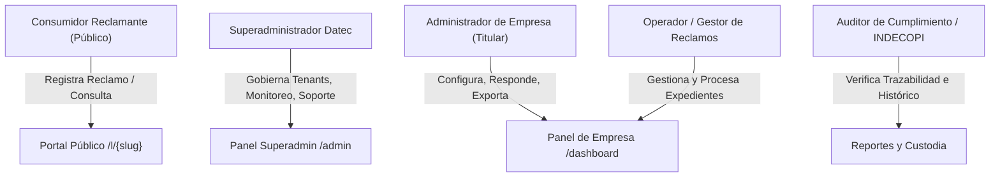
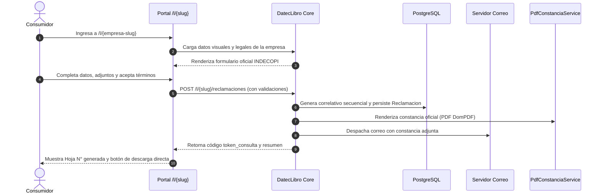
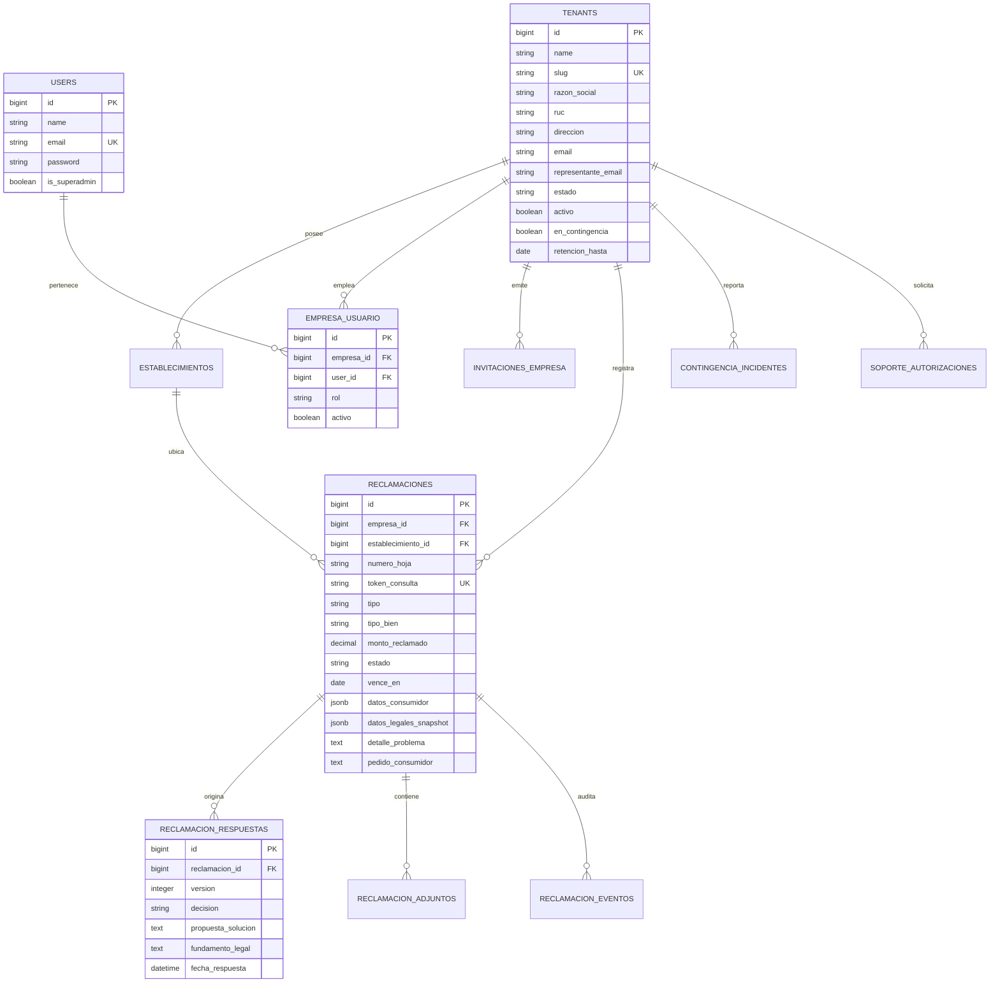

# ESPECIFICACIÓN DE REQUISITOS DE SOFTWARE (SRS)
## Sistema de Gestión Multiempresa de Libro de Reclamaciones Virtual
### Conforme al Código de Protección y Defensa del Consumidor (Ley N° 29571), D.S. N° 011-2011-PCM y Ley N° 31435

---

| **Documento:** | Especificación de Requisitos de Software (SRS) |
|---|---|
| **Proyecto:** | DatecLibro - Plataforma SaaS Multiempresa de Libro de Reclamaciones |
| **Versión:** | 2.0 (Actualizada y Consolidada) |
| **Fecha:** | Noviembre 2026 |
| **Organización:** | Datec Consulting S.A.C. |
| **Estado:** | Aprobado / En Producción |

---

## 1. Introducción y Control del Documento

### 1.1 Propósito
El presente documento establece la Especificación de Requisitos de Software (SRS) formal, completa y actualizada para la plataforma **DatecLibro**. Define con precisión técnica y legal las capacidades funcionales, los requisitos no funcionales, las reglas de negocio, los modelos de datos, las medidas de seguridad y los flujos operativos de la plataforma, sirviendo como contrato técnico de referencia para el equipo de desarrollo, auditores de calidad y autoridades de fiscalización (INDECOPI).

### 1.2 Audiencia
- **Equipo de Ingeniería y Desarrollo:** Arquitectos de software, desarrolladores Full Stack (PHP/Laravel, Inertia.js, Vue 3, TypeScript, Tailwind CSS).
- **Dirección y Operaciones de Datec:** Administradores centrales de la plataforma y soporte de infraestructura.
- **Clientes Corporativos (Tenants):** Representantes legales, oficiales de cumplimiento y administradores de empresas afiliadas.
- **Auditores y Reguladores:** Inspectores de INDECOPI y auditores de protección de datos personales (MINJUSDH).

### 1.3 Convenciones y Nomenclatura
- **RF:** Requisito Funcional.
- **RNF:** Requisito No Funcional.
- **RN:** Regla de Negocio / Legal.
- **RS:** Requisito de Seguridad y Protección de Datos.
- **Tenant:** Organización o empresa cliente suscrita que opera de forma aislada dentro de la plataforma compartida.
- **INDECOPI:** Instituto Nacional de Defensa de la Competencia y de la Protección de la Propiedad Intelectual (Perú).

### 1.4 Historial y Control de Cambios

| Versión | Fecha | Autor / Rol | Descripción del Cambio |
|:---:|:---:|:---|:---|
| 1.0 | 2026-10-15 | Equipo Datec | Versión inicial de especificación (MVP y arquitectura multiempresa base). |
| 2.0 | 2026-11-11 | Lead Architect Datec | Consolidación integral v2: rediseño de constancias y reportes PDF DomPDF (formato oficial INDECOPI), ciclo de vida completo de tickets de soporte (`finalizado`/`resuelto`), aislamiento estricto de sesiones fantasma, sincronización atómica de titular de empresa (Pilar B), invalidación de invitaciones previas, bitácora de contingencia, exportación dual (PDF/CSV) y monitoreo de salud con purga de auditoría. |

---

## 2. Visión del Producto y Alcance

### 2.1 Visión del Producto
Proveer una solución integral en la nube (Software as a Service - SaaS) de Libro de Reclamaciones Virtual que permita a múltiples organizaciones en el Perú cumplir estrictamente con las directrices de INDECOPI, centralizando la gobernanza técnica y operativa en Datec, pero garantizando el aislamiento criptográfico, de datos y visual de cada empresa cliente.

### 2.2 Marco Regulatorio y Legal Aplicable
1. **Ley N° 29571:** Código de Protección y Defensa del Consumidor.
2. **Decreto Supremo N° 011-2011-PCM:** Reglamento del Libro de Reclamaciones y sus modificatorias (D.S. N° 006-2014-PCM).
3. **Ley N° 31435:** Modificatoria que fija el plazo legal perentorio de **quince (15) días hábiles improrrogables** para la atención y respuesta de reclamos y quejas.
4. **Ley N° 29733:** Ley de Protección de Datos Personales (LPDP) y su reglamento (D.S. N° 003-2013-JUS), en lo relativo al consentimiento, tratamiento de datos sensibles y deber de confidencialidad.

### 2.3 Alcance Operativo (En Scope)
- Portal público de registro accesible mediante URL única `/l/{slug}` y widgets embebibles.
- Clasificación tipificada obligatoria: **Reclamo** (bienes o servicios) vs. **Queja** (atención al público).
- Generación automática de numeración correlativa anual por empresa o sede (formato `NNNNNN-YYYY`).
- Emisión inmediata de constancia digital en PDF con layout institucional INDECOPI y despacho por correo electrónico.
- Módulo de consulta de estado para el consumidor mediante token alfanumérico seguro.
- Bandeja corporativa de expedientes con filtrado avanzado, semáforo de vencimiento legal y asignación interna.
- Motor de respuesta formal motivada con versionado, registro de dictamen y notificación certificada.
- Generación de reportes ejecutivos y de fiscalización en formatos PDF Landscape y CSV con BOM UTF-8.
- Modo de contingencia técnica con bitácora de incidentes y canal alternativo normativo.
- Módulo de salida de cliente con custodia legal probatoria de dos (2) años en archivo ZIP cifrado.
- Superadministrador global con monitoreo de colas, salud de base de datos y auditoría de accesos.

---

## 3. Actores y Matriz de Roles



### 3.1 Definición de Actores

1. **Consumidor Reclamante (Público / Anónimo autenticado):**
   - Persona natural o jurídica que interactúa con la plataforma sin necesidad de credenciales previas para presentar un reclamo o queja ante una empresa, o consultar la trazabilidad de su trámite mediante su código único.

2. **Superadministrador Datec (`is_superadmin = true`):**
   - Personal técnico y legal de Datec Consulting con privilegios globales. Gestiona el ciclo de vida de los tenants (empresas), audita el sistema, resuelve alertas de plataforma, supervisa colas de mensajería y atiende solicitudes de soporte técnico delegado.

3. **Administrador de Empresa (`rol = admin_empresa`):**
   - Usuario titular designado por la empresa cliente. Posee gobierno total sobre su espacio de trabajo: configuración de identidad legal, personalización de colores/logo, gestión de sedes/establecimientos, administración de operadores internos, activación de contingencia, emisión de respuestas oficiales y exportación de reportes.
   - **Regla de unicidad estricta:** Cada empresa cuenta con un administrador titular principal enlazado atómicamente a su ficha corporativa (`representante_email`).

4. **Operador / Gestor de Reclamos (`rol = gestor` / `operador`):**
   - Colaborador de la empresa asignado a la recepción, análisis preliminar, anexión de descargos internos y redacción de propuestas de respuesta para los expedientes de su establecimiento asignado.

5. **Auditor Externo / Supervisor INDECOPI:**
   - Entidad o inspector que fiscaliza el cumplimiento normativo mediante la exhibición de reportes consolidados, hojas de reclamación foliadas y bitácoras de eventos.

---

## 4. Arquitectura y Decisiones Tecnológicas

```
+-----------------------------------------------------------------------------------+
|                                 CLIENT LAYER                                      |
|   Tailwind CSS  •  Vue 3 (Composition API)  •  TypeScript  •  Inertia.js v3      |
+-----------------------------------------------------------------------------------+
                                         │  (Inertia Protocol / JSON Hydration)
+-----------------------------------------------------------------------------------+
|                              APPLICATION LAYER                                    |
|   Laravel 11.x (PHP 8.4)  •  Spatie Multitenancy  •  Pest PHP  •  Laravel Pint    |
|   Middlewares: EnsureSuperAdmin, EnsureTenantAccess, ResolveTenantBySlug          |
+-----------------------------------------------------------------------------------+
                                         │  (Service Layer & Domain Contracts)
+-----------------------------------------------------------------------------------+
|                           SERVICES & WORKERS LAYER                                |
|   PdfConstanciaService (DomPDF)   •   PlazoAtencionService (Feriados/Hábiles)     |
|   AuditoriaService (Event-driven) •   SalidaClienteService (ZIP Custodia 2 Años)  |
|   Laravel Queue Workers (Notificaciones Asíncronas & Logs Sanitizados)            |
+-----------------------------------------------------------------------------------+
                                         │  (PostgreSQL Connection & Storage)
+-----------------------------------------------------------------------------------+
|                             DATA & STORAGE LAYER                                  |
|   PostgreSQL 16 (Multi-tenant aislado por tenant_id)  •  Local/S3 Encrypted Disk   |
+-----------------------------------------------------------------------------------+
```

### 4.1 Decisiones Tecnológicas Clave

| Capa | Tecnología | Justificación Técnica |
|---|---|---|
| **Lenguaje Base** | PHP 8.4 | Tipado estricto, constructor promotion, validaciones nativas de alto rendimiento. |
| **Framework Backend** | Laravel 11.x | Arquitectura robusta, colas integradas, sistema de migraciones, Eloquent ORM y soporte de seguridad de nivel bancario. |
| **Arquitectura SPA** | Inertia.js v3 | Experiencia de usuario SPA reactiva sin la sobrecarga de crear y mantener una API REST intermedia duplicada. |
| **Frontend** | Vue 3 + TypeScript | Componentes reactivos fuertemente tipados, modularidad y prevención de errores en compilación. |
| **Motor de Estilos** | Tailwind CSS v3 | Sistema de diseño utilitario altamente consistente, responsivo y de bajo peso. |
| **Multi-Tenancy** | Spatie Multitenancy | Aislamiento lógico de alto rendimiento sobre una base de datos centralizada con discriminador `tenant_id` / `empresa_id` estricto en cada consulta. |
| **Motor de Reportes PDF** | Barryvdh/Laravel-DomPDF | Renderizado en servidor de documentos PDF A4 (Portrait y Landscape) 100% compatibles con lineamientos formales y sin dependencias de Node/Chromium en el servidor. |
| **Base de Datos** | PostgreSQL 16 | Soporte robusto de transacciones ACID, índices optimizados y campos JSONB para snapshots inmutables de reclamaciones. |

---

## 5. Reglas de Negocio Globales (RN)

- **RN-001 (Plazo Perentorio INDECOPI):** Todo reclamo o queja debe ser resuelto y notificado formalmente al consumidor en un plazo improrrogable de **15 días hábiles**. El cómputo excluye sábados, domingos y el catálogo de feriados nacionales peruanos.
- **RN-002 (Inmutabilidad de la Reclamación):** Una vez que el consumidor envía el formulario y se genera el número correlativo, el contenido original (hechos, bien contratado, pedido y montos) no puede ser modificado ni eliminado por ningún usuario ni empresa bajo ninguna circunstancia.
- **RN-003 (Snapshot del Proveedor):** La reclamación almacena una copia estática e inalterable (`datos_legales_snapshot`) de la razón social, RUC y domicilio de la empresa al momento exacto de la presentación, protegiendo la validez probatoria ante futuros cambios corporativos.
- **RN-004 (Unicidad del Administrador Titular):** Una empresa solo puede tener un administrador titular activo (`admin_empresa`). El correo de dicho usuario debe coincidir con el correo institucional de la empresa. La aceptación de un nuevo administrador titular reemplaza y extingue el acceso del anterior.
- **RN-005 (Custodia Legal de 24 Meses):** La baja comercial de una empresa en DatecLibro no implica la destrucción de su información. El sistema entra en fase de retención de custodia por 2 años, generando un paquete probatorio descargable (`.zip`) con hash SHA-256.
- **RN-006 (Exclusión Cruzada de Datos - Anti Cross-Tenant):** Ningún usuario de una empresa puede leer, escribir o inferir la existencia de expedientes, configuraciones o catálogos pertenecientes a otra empresa.

---

## 6. Requisitos Funcionales Detallados

### Módulo 1: Administración Global y Gobierno de Plataforma (Superadmin)

#### [RF-001] Gestión Integral de Empresas (Tenants)
- **Descripción:** El Superadministrador debe poder registrar, listar, filtrar y editar empresas clientes.
- **Datos requeridos:** Nombre comercial, razón social, RUC (11 dígitos numéricos validados), dirección legal, correo corporativo de contacto, teléfono y slug único de acceso público.
- **Criterio de Aceptación:** El slug solo admite caracteres alfanuméricos y guiones (`/^[a-z0-9-]+$/`). El RUC debe ser único entre las empresas activas.

#### [RF-002] Ciclo de Vida y Transición de Estados Corporativos
- **Descripción:** El sistema debe gestionar los estados de cada tenant: `borrador`, `activa`, `suspendida`, `baja_programada`.
- **Comportamiento:**
  - Al cambiar de estado, se debe registrar obligatoriamente el motivo del cambio y el usuario responsable en auditoría.
  - Una empresa `suspendida` bloquea inmediatamente el acceso a sus paneles internos y muestra un mensaje informativo en su URL pública (`403 Forbidden`).
  - Al reactivar una empresa (`activa`), se reactivan automáticamente los accesos de sus usuarios administradores.

#### [RF-003] Planes y Límites Comerciales
- **Descripción:** Control de planes de servicio (`Básico`, `Profesional`, `Corporativo`) con vigencia contractual (`vigencia_desde`, `vigencia_hasta`) y umbrales preventivos de expedientes mensuales.

#### [RF-004] Invitación y Activación de Administrador de Empresa (Pilar B)
- **Descripción:** El Superadmin debe poder invitar al administrador titular de la empresa mediante token seguro de uso único con vigencia de 72 horas.
- **Comportamiento Crítico:**
  - Si la empresa ya tenía un administrador anterior, al aceptar la nueva invitación se actualiza de forma atómica la cuenta existente o se desvincula y elimina la cuenta obsoleta, impidiendo la coexistencia de 2 credenciales para el panel administrador.
  - Al generar una nueva invitación, se invalidan de forma inmediata todas las invitaciones pendientes previas de esa empresa.
  - Se provee botón de copia directa y generación automática de enlace Gmail (`https://mail.google.com/mail/?view=cm...`) con asunto y cuerpo oficial prellenados.

#### [RF-005] Monitoreo de Salud Operativa y Cola de Trabajos
- **Descripción:** Panel de supervisión técnica global que diagnostica:
  - Estado de conectividad de la base de datos PostgreSQL.
  - Trabajos fallidos en segundo plano (`failed_jobs`) con sanitización de datos personales.
  - Botón para reintentar trabajos asíncronos de forma individual o masiva (`reintentar-todos`).
  - Detección preventiva de empresas con vencimiento de suscripción próximo (30 días).

---

### Módulo 2: Portal Público del Consumidor



#### [RF-013] Acceso Público y Cero Barreras
- **Descripción:** El consumidor debe acceder directamente mediante enlace limpio `/l/{slug}` sin requerir login, registro de cuenta ni descargas previas de software.

#### [RF-014] Identificación del Consumidor Reclamante
- **Descripción:** Captura de datos obligatorios:
  - Nombres y Apellidos completos.
  - Tipo de documento (`DNI`, `CE`, `RUC`, `Pasaporte`) y Número de documento.
  - Correo electrónico válido (canal legal de notificación).
  - Teléfono / celular de contacto.
  - Domicilio físico (Dirección, Departamento, Provincia y Distrito).
  - En caso de menores de edad: Checkbox obligatorio que habilita la captura de datos del Padre, Madre o Apoderado (Nombre completo y Documento).

#### [RF-015] Identificación del Bien Contratado
- **Descripción:** Selección obligatoria entre **Producto** o **Servicio**, descripción del bien, monto reclamado con selección de moneda (`PEN` / `USD`) y número de comprobante de pago o contrato de referencia.

#### [RF-016] Tipificación Estricta: Reclamo vs. Queja
- **Descripción:** Selector visual excluyente con explicaciones normativas claras:
  - **Reclamo:** Disconformidad con el producto o servicio suministrado.
  - **Queja:** Malestar o disconformidad en la atención al público.

#### [RF-017] Detalle de Disconformidad y Pedido Concreto
- **Descripción:** Dos campos de texto enriquecido independientes con longitud mínima de 10 caracteres:
  1. *Detalle del reclamo o queja:* Relato cronológico de los hechos ocurridos.
  2. *Pedido del consumidor:* Solución específica solicitada (cambio de producto, devolución de dinero, disculpas formales, etc.).

#### [RF-019] Mecanismos Anti-Abuso y Prevención de Bots
- **Descripción:**
  - Rate Limiting de 5 solicitudes por hora por dirección IP en endpoints de registro.
  - Campo trampa invisible (*honeypot*) para descarte silencioso de scripts maliciosos.
  - Sanitización estricta de entradas para prevenir inyecciones XSS y SQL.

#### [RF-020] Foliación Correlativa Secuencial
- **Descripción:** Generación atómica del número de hoja bajo bloqueo de concurrencia (`LOCK FOR UPDATE`), con formato `NNNNNN-YYYY` (ej: `000142-2026`), único por empresa.

#### [RF-022] Emisión Inmediata de Constancia Digital PDF
- **Descripción:** El sistema debe compilar en el acto el archivo PDF oficial con layout DomPDF y paleta corporativa/roja INDECOPI, permitiendo la descarga instantánea en la pantalla de éxito.

#### [RF-023] Notificación Automática por Correo
- **Descripción:** Envío asíncrono vía cola de correos al email del consumidor con la constancia PDF adjunta, número de hoja y enlace directo con su código de seguimiento.

#### [RF-025] Consulta de Estado sin Exposición de Datos
- **Descripción:** Portal `/consulta` donde el consumidor ingresa su `token_consulta` y su número de documento para verificar el estado de su reclamo, plazos restantes y descargar respuestas emitidas, sin exponer datos a terceros.

---

### Módulo 3: Gestión de Expedientes y Ficha de Reclamación (Empresa)

#### [RF-026] Bandeja de Expedientes con Filtros Avanzados
- **Descripción:** Listado tabular paginado (15 registros por página) con filtros por:
  - Estado: `pendiente`, `en_tramite`, `atendida`, `cerrada`.
  - Tipo: `reclamo`, `queja`.
  - Búsqueda textual: por número de hoja, documento, nombre del consumidor o código de seguimiento.
  - Rango de fechas de emisión.
  - Semáforo de vencimiento legal: Normal, Preventivo (3 días) y Vencido.

#### [RF-027] Ficha Integral del Expediente
- **Descripción:** Visualización de 360 grados que contiene:
  - Datos de origen inmutables del consumidor y del bien.
  - Snapshot de datos legales del proveedor al momento del registro.
  - Archivos adjuntos aportados por el consumidor.
  - Responsable interno asignado.
  - Línea de tiempo cronológica de actuaciones y eventos.
  - Historial de respuestas y dictámenes formales.

#### [RF-030] Emisión de Respuesta Formal Motivada
- **Descripción:** Formulario de respuesta que exige:
  - **Dictamen:** `Fundado`, `Parcialmente Fundado`, `Infundado`, `Concluido`.
  - **Propuesta de Solución:** Detalle de las acciones adoptadas para subsanar la disconformidad.
  - **Fundamento Legal / Técnico:** Justificación normativa motivada según INDECOPI.
  - **Versionado:** Cada emisión genera una nueva versión inmutable (`v1`, `v2`) conservando el historial previo.

#### [RF-031] Despacho y Notificación Certificada de Respuesta
- **Descripción:** Al emitir la respuesta, se despacha un correo oficial al consumidor con la nueva constancia PDF que incorpora la sección *4. Acciones Adoptadas por el Proveedor y Dictamen*, cambiando automáticamente el estado a `atendida`.

#### [RF-033] Exportación de Reportes Oficiales
- **Descripción:**
  - **Exportación en PDF:** Formato A4 Landscape con métricas KPI (total, reclamos, quejas, pendientes, atendidos), desglose de semáforos, filtros activos y pie de página confidencial.
  - **Exportación en CSV:** Archivo estructurado con codificación `UTF-8 con BOM` para apertura nativa y sin corrupción de caracteres en Microsoft Excel.

---

### Módulo 4: Configuración, Identidad y Contingencia (Empresa)

#### [RF-008] Identidad Legal Corporativa
- **Descripción:** Edición de razón social, RUC, dirección fiscal, teléfono y correo oficial de la empresa.

#### [RF-009] Personalización de Marca y Enlaces de Integración
- **Descripción:**
  - Carga y procesamiento de logotipo corporativo (formatos PNG/JPG/WebP hasta 2MB).
  - Selección de color primario corporativo para portales y correos.
  - Generador de código HTML para el footer del sitio web de la empresa:
    - *Botón estándar con logotipo oficial del Libro de Reclamaciones.*
    - *Enlace de texto normativo.*
    - *Widget flotante en esquina inferior derecha.*
    - *Enlace de consulta de estado.*

#### [RF-010] Gestión de Establecimientos / Sedes
- **Descripción:** Registro de sedes físicas o virtuales con código interno, nombre y dirección, permitiendo definir la **Sede Principal**.

#### [RF-040] Modo de Contingencia Operativa de Plataforma
- **Descripción:** En caso de fallas técnicas o mantenimientos programados:
  - La empresa o el Superadmin pueden activar el modo contingencia.
  - El portal público bloquea el formulario regular y muestra el **Canal Alternativo de Contingencia** (correo electrónico de guardia y/o formato descargable en PDF).
  - Se registra de forma inmutable el incidente en `contingencia_incidentes` (inicio, fin estimado, motivo y resolución) para sustento ante fiscalizaciones de INDECOPI.

#### [RF-041] Salida de Cliente y Paquete de Custodia Legal Probatoria
- **Descripción:** En caso de resolución de contrato o baja definitiva:
  - Se genera un paquete `.zip` comprimido y firmado digitalmente mediante hash SHA-256.
  - Contiene todos los expedientes, respuestas, adjuntos y registros de auditoría de los 2 años previos.
  - Solo el Superadmin puede autorizar la descarga del paquete probatorio.

---

### Módulo 5: Soporte Técnico Delegado y Auditoría

#### [RF-038] Soporte Técnico y Acceso Delegado con Ciclo Completo
- **Descripción:** Flujo estructurado de solicitudes de soporte entre la empresa cliente y Datec:
  - **Estados:** `pendiente` -> `en_revision` -> `autorizado` -> `rechazado` -> `finalizado` / `resuelto`.
  - La empresa solicita asistencia describiendo la incidencia.
  - El Superadmin puede solicitar acceso temporal delegado con expiración en horas.
  - Botón de **"Finalizar / Resolver Incidencia"** con registro de notas técnicas de resolución.

#### [RF-037] Auditoría General Inmutable
- **Descripción:** Registro cronológico de todas las operaciones críticas:
  - Inicios de sesión de superadministradores y administradores.
  - Modificaciones en identidad legal o cambios de slug.
  - Activaciones de contingencia y exportaciones de datos.
  - Toda entrada contiene: `evento`, `modulo`, `descripcion`, `usuario_id`, `ip`, `user_agent` y snapshot `datos_despues`.

---

## 7. Requisitos No Funcionales (RNF)

### 7.1 Rendimiento y Eficiencia (RNF-001)
- El tiempo de respuesta del servidor (TTFB) en la renderización del formulario público no debe exceder los **400 ms** bajo condiciones normales de red.
- La generación y streaming del archivo PDF de la constancia no debe superar los **1.5 segundos**.

### 7.2 Disponibilidad y Resiliencia (RNF-002)
- Disponibilidad global del servicio objetivo del **99.5%** anual.
- Procesamiento desacoplado: si el servidor de correo se encuentra caído, la reclamación se registra exitosamente en la base de datos y el correo queda en cola de reintentos con respaldo en `failed_jobs`.

### 7.3 Seguridad y Privacidad (RNF-003)
- Todas las comunicaciones cliente-servidor se efectúan obligatoriamente sobre protocolo **HTTPS / TLS 1.3**.
- Las contraseñas de los usuarios se almacenan mediante hashing **Bcrypt** con factor de coste 12.
- Aislamiento estricto de sesiones: si un usuario o empresa es dado de baja, el middleware `HandleInertiaRequests` detecta la pérdida de membresía y destruye la sesión activa de inmediato.
- Los tokens de invitaciones y de consulta al consumidor son cadenas pseudoaleatorias de 48 caracteres generadas mediante generadores criptográficamente seguros (`Str::random(48)`).

### 7.4 Compatibilidad Multiplataforma (RNF-004)
- El formulario público y el portal de consulta son 100% responsivos y compatibles con navegadores modernos (Google Chrome, Mozilla Firefox, Apple Safari, Microsoft Edge) tanto en escritorio como en dispositivos móviles iOS y Android.

---

## 8. Modelo de Datos y Entidades Principales



### 8.1 Catálogo de Enums del Sistema

1. **`EstadoEmpresa`:** `Borrador ('borrador')`, `Activa ('activa')`, `Suspendida ('suspendida')`, `BajaProgramada ('baja_programada')`.
2. **`RolEmpresa`:** `AdminEmpresa ('admin_empresa')`, `Gestor ('gestor')`, `Operador ('operador')`, `Supervisor ('supervisor')`.
3. **`TipoReclamacion`:** `Reclamo ('reclamo')`, `Queja ('queja')`.
4. **`TipoBien`:** `Producto ('producto')`, `Servicio ('servicio')`.
5. **`EstadoReclamacion`:** `Pendiente ('pendiente')`, `EnTrámite ('en_tramite')`, `Atendida ('atendida')`, `Cerrada ('cerrada')`.
6. **`DecisionRespuesta`:** `Fundado ('fundado')`, `ParcialmenteFundado ('parcialmente_fundado')`, `Infundado ('infundado')`, `Concluido ('concluido')`.

---

## 9. Matriz de Trazabilidad de Requisitos

| ID Requisito | Descripción Sintética | Componente Backend | Componente Frontend (Vue) | Estado de Verificación |
|:---:|:---|:---|:---|:---:|
| **RF-001** | Alta y Edición de Empresas | `Admin\EmpresaController` | `Admin/Empresas/Index`, `Edit` | Verificado (Tests pasan) |
| **RF-004** | Invitación y reemplazo de admin (Pilar B) | `Admin\InvitacionController` | `Admin/Empresas/Index` (Modal) | Verificado (Tests pasan) |
| **RF-006** | Aislamiento estricto multi-tenant | `EnsureTenantAccess` | Middlewares / Rutas | Verificado (Tests pasan) |
| **RF-013** | Portal público por slug | `LibroReclamacionesController` | `Publico/LibroReclamaciones` | Verificado (Tests pasan) |
| **RF-016** | Distinción Reclamo vs Queja | `StoreReclamacionRequest` | `Publico/LibroReclamaciones` | Verificado (Tests pasan) |
| **RF-020** | Foliación única anual correlativa | `ReclamacionCorrelativoService`| `Publico/ConstanciaExito` | Verificado (Tests pasan) |
| **RF-022** | Generación de Constancia PDF | `PdfConstanciaService` | `pdf.constancia_reclamacion` | Verificado (DomPDF OK) |
| **RF-025** | Consulta de Estado con Token | `ConsultaEstadoController` | `Publico/ConsultaEstado` | Verificado (Tests pasan) |
| **RF-026** | Bandeja de Expedientes y Filtros | `Empresa\ExpedienteController`| `Empresa/Expedientes/Index` | Verificado (Tests pasan) |
| **RF-030** | Emisión de Respuesta motivada | `Empresa\RespuestaController` | `Empresa/Expedientes/Show` | Verificado (Tests pasan) |
| **RF-032** | Semáforo de 15 días hábiles | `PlazoAtencionService` | Componentes de semáforo | Verificado (Tests pasan) |
| **RF-033** | Exportación PDF Landscape y CSV | `Empresa\ExpedienteController`| `pdf.reporte_reclamaciones` | Verificado (Tests pasan) |
| **RF-038** | Soporte con ciclo finalizado | `Admin\SoporteController` | `Admin/Soporte/Index` | Verificado (Tests pasan) |
| **RF-040** | Bitácora de Contingencia | `Empresa\ContingenciaController`| `Empresa/Contingencia/Index` | Verificado (Tests pasan) |
| **RF-041** | Custodia de 2 años y paquete ZIP | `SalidaClienteService` | `Admin/Empresas/Index` | Verificado (Tests pasan) |

---

## 10. Glosario de Términos

- **Consumidor:** Persona natural o jurídica que adquiere, utiliza o disfruta como destinatario final productos o servicios materiales o inmateriales.
- **Dictamen de Respuesta:** Determinación fundamentada que adopta el proveedor respecto a la solicitud formulada por el reclamante.
- **Foliación Correlativa:** Numeración secuencial e ininterrumpida que identifica de forma unívoca a cada hoja de reclamación emitida durante un ejercicio anual.
- **Hoja de Reclamación:** Documento físico o digital en el que el consumidor formaliza su reclamo o queja conforme a las pautas del D.S. N° 011-2011-PCM.
- **Plazo Improrrogable:** Término perentorio de 15 días hábiles dentro del cual la empresa está obligada a contestar al consumidor sin posibilidad de solicitar prórrogas.
- **Sello de Tiempo (Timestamp):** Registro digital fehaciente de la fecha, hora, minuto y segundo en que se produjo la interacción.
- **Spatie Multitenancy:** Módulo de aislamiento de contexto que garantiza la conmutación segura de tenants en tiempo de ejecución.

